# Nox

A personal AI assistant that has run every day since April 2026: a Telegram bot, an Android app and a background agent on a self-hosted server. Single user, private code. This repository is the showcase: what it does and how it is built.

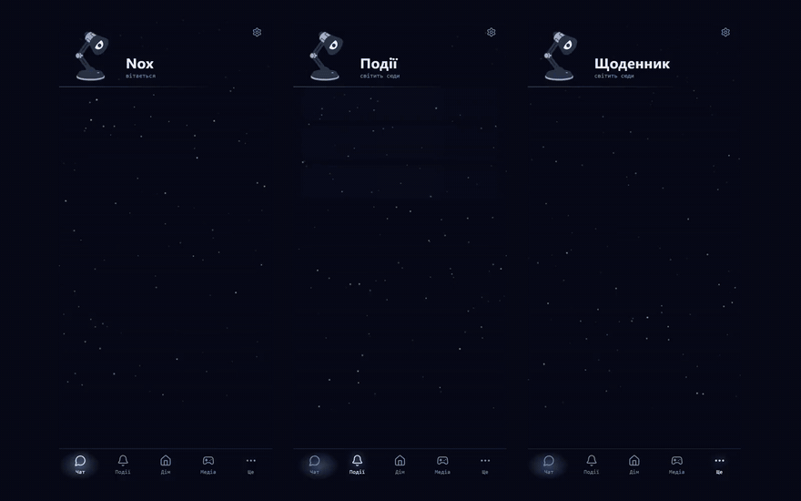

Recorded from v9.23 with a fictional owner and seeded data. The interface is in Ukrainian, the language it is used in. Full clips of all ten screens: [btwstudio.dev/work/nox](https://btwstudio.dev/work/nox).

| Chat | Events | Watchdog | Tasks and projects | Planner |
|---|---|---|---|---|
|  |  | 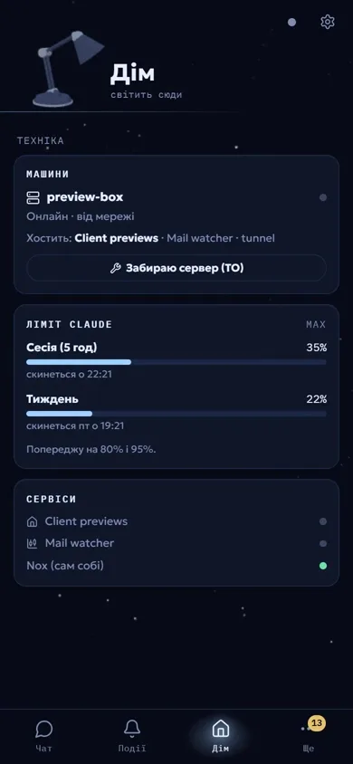 | 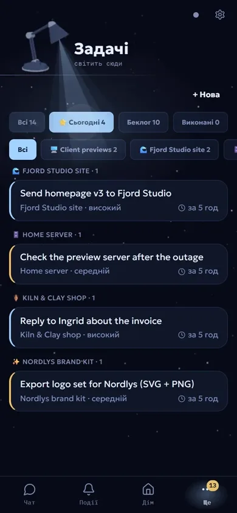 | 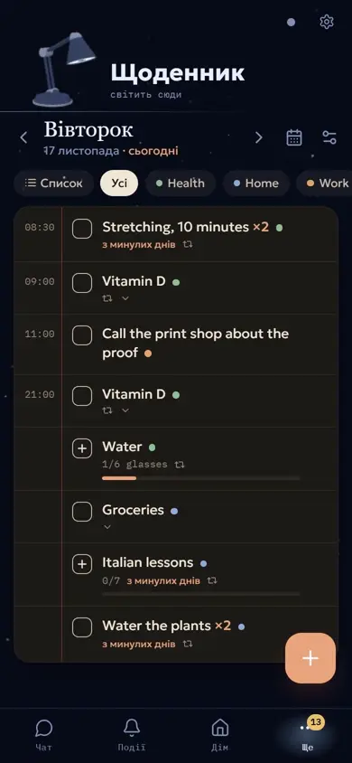 |
| An answer with its steps and a result card | Signals grouped by source | One alert per outage, false alarms swallowed | Today, deadlines, progress | Counters, checklists, a study journal |

| Finances | Home | Mail | News | Content |
|---|---|---|---|---|
| 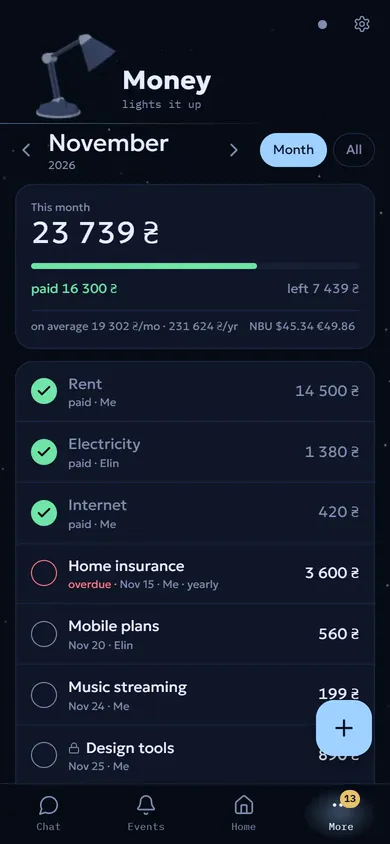 | 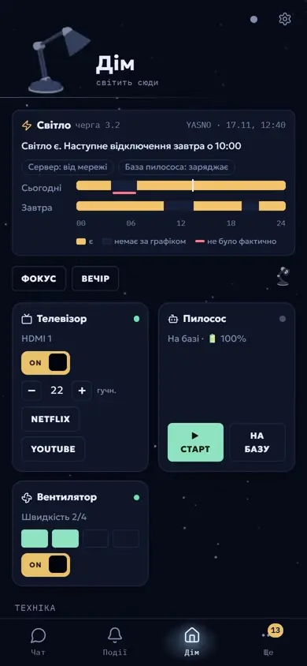 | 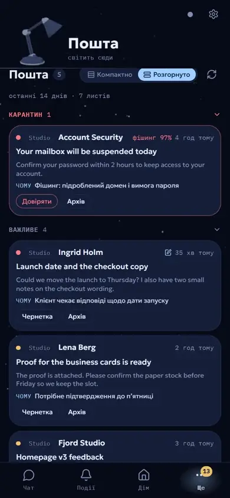 | 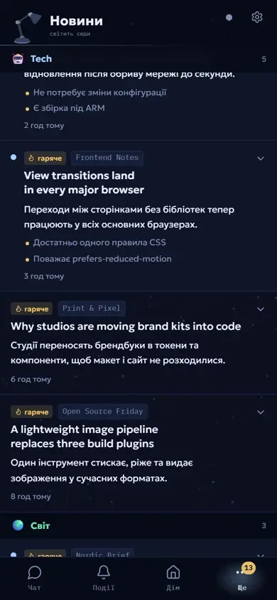 | 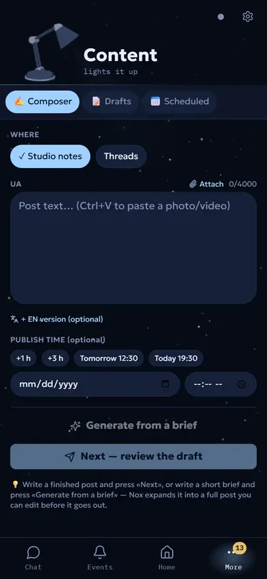 |
| Shared recurring payments, who pays, what is overdue | Power schedule, devices, server and model limits | What matters first, phishing quarantined with a reason | A feed by topic with a short summary | Drafts and scheduled posts for a channel |

In the home, mail, news and content recordings the data comes from fictional responses, because the real sources are the owner's smart home, mailbox and channel.

### The same app in English

A [2.5-minute walkthrough](https://btwstudio.dev/work/nox) of v9.24, recorded with the interface switched to English for the shoot. Chat replies in it are replayed from a script, and the rows on screen are demo data.

| Chat | Approval | Events | Mail | Orders | Planner |
|---|---|---|---|---|---|
| 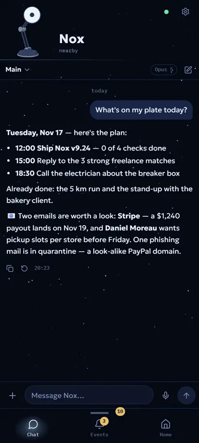 | 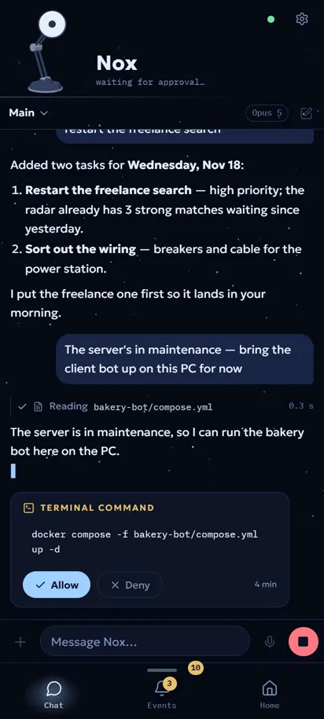 |  | 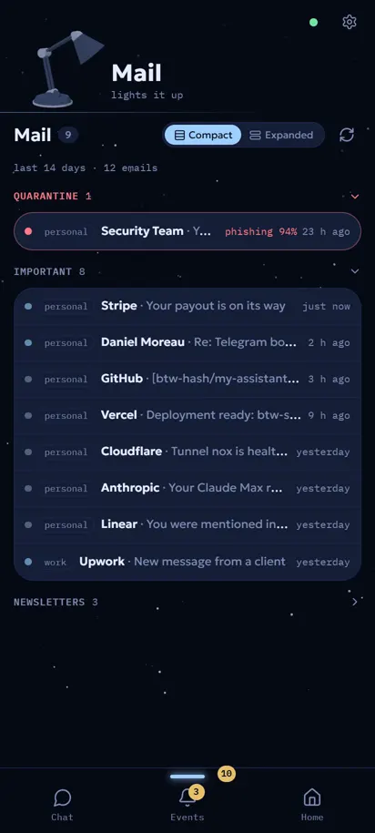 | 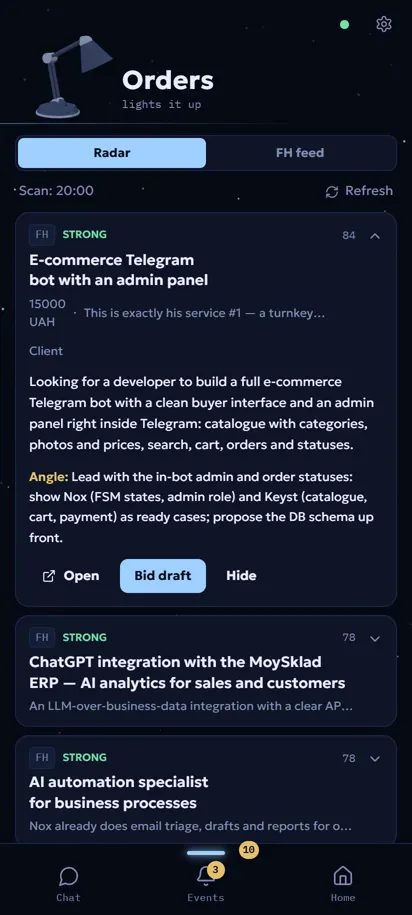 | 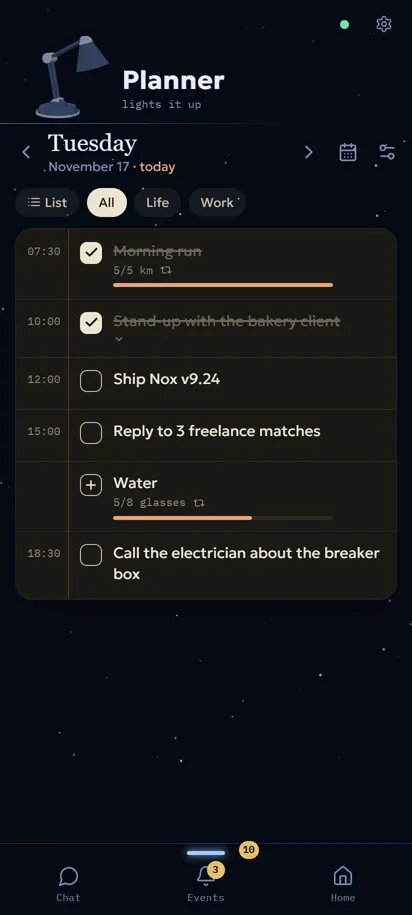 |
| One answer from the planner, tasks and mail | A shell command waits for Allow | Important first | Phishing in quarantine | Scored freelance jobs with a drafted bid | The day by the hour |

| Money | Home | Tasks | Projects | News | Content |
|---|---|---|---|---|---|
| 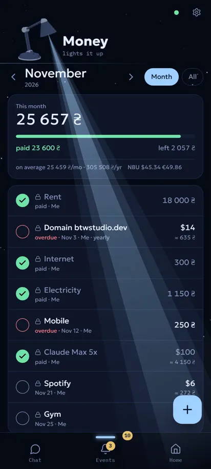 | 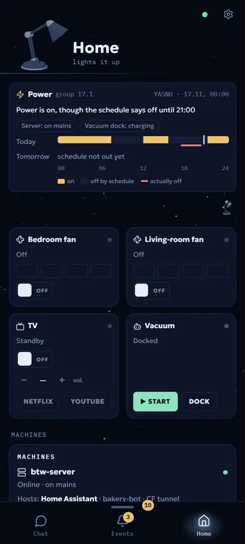 | 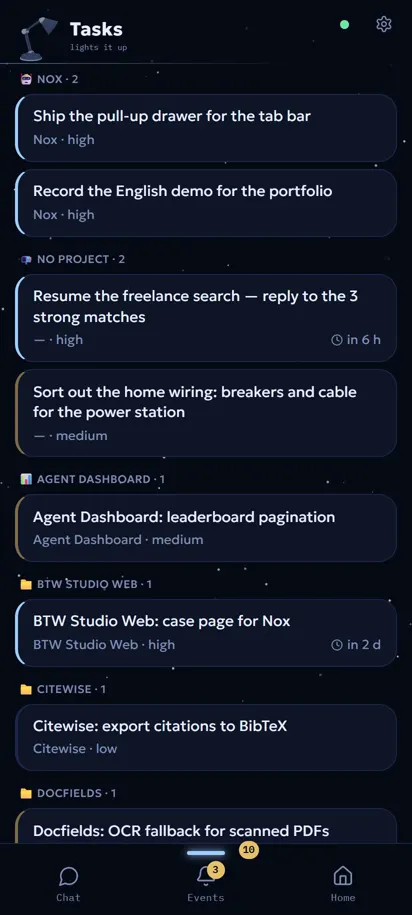 | 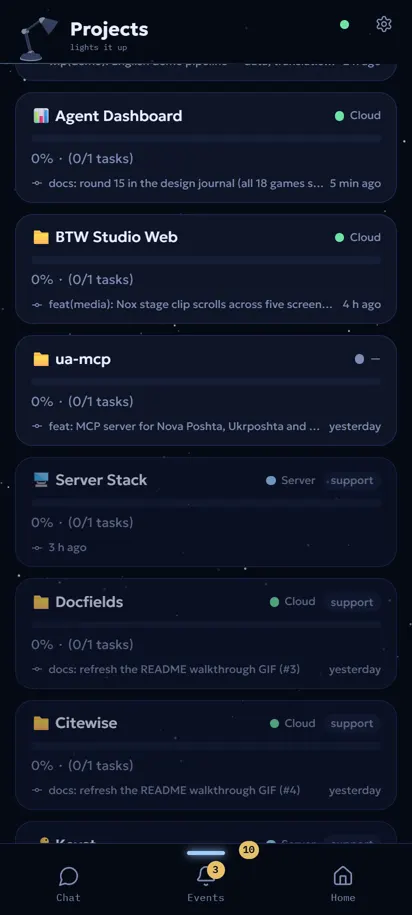 | 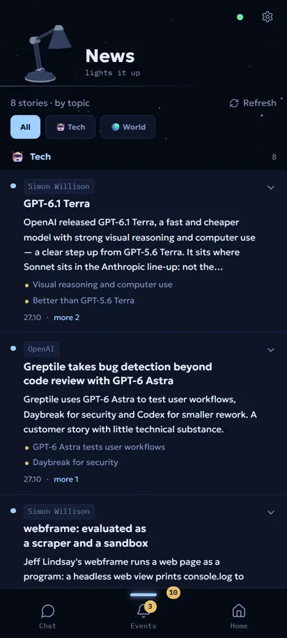 | 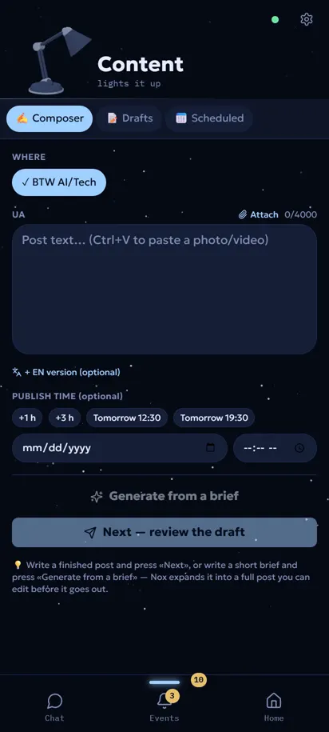 |
| Paid, overdue, left this month | Power schedule and devices | Grouped by project | Status and the last commit | A digest by topic | Compose, draft, schedule |

## What it does

- **Chat with tools.** Tasks, backlog, mail, projects and news are reachable from one conversation; answers show their steps and survive a restart.
- **Events instead of noise.** Incoming signals (client replies, accepted orders, server incidents) land as cards with one notification per batch, read items move to an archive.
- **Self-monitoring.** A watchdog tracks the server and its services. One outage produces one alert, recovery is silent, and a narrow set of repairs (for example restarting a single named container) runs without a human.
- **A weekly planner.** One day per screen: tasks, checklists, counters and a study journal. Unfinished items carry over by themselves and repeating ones accumulate instead of merging.
- **Shared finances.** Recurring household payments with a payer, a due day and a monthly total; overdue items stand out and one tap marks a payment.
- **Home.** Smart-home devices and scenes, a power-outage schedule checked against what the server and a charging dock actually observed.
- **Mail triage.** Important messages first, newsletters folded away, phishing quarantined with the reason stated, reply drafts awaiting approval.
- **News.** A feed by topic where every item has a short summary.
- **Voice in.** Speech is transcribed locally on a GPU before it reaches the model.
- **Content pipeline.** Drafting, scheduling and publishing posts to a Telegram channel.
- **Updates without reinstalling.** The Android shell is rebuilt only when native code changes; the interface updates itself over the air.

## Architecture

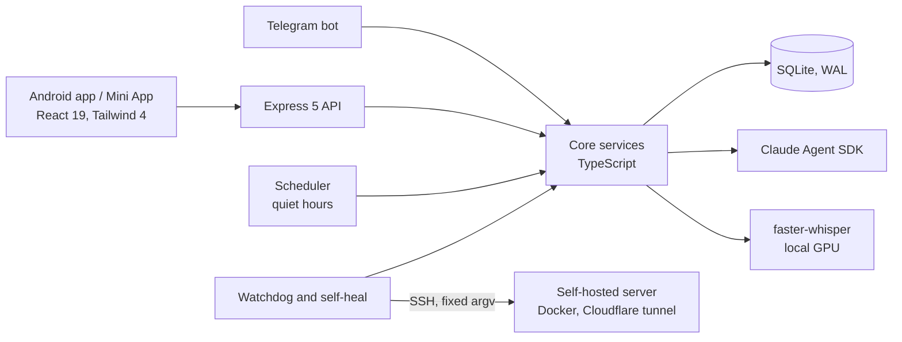

## Engineering notes

- **An automated test suite** (Vitest) runs in a pre-commit hook and in CI.
- **Model access behind one module**, so the model or tier changes in one place.
- **Dead features are switched off by list, then deleted.** A usage audit over the full history retired ten modules that nobody used.
- **Side effects get a real smoke test.** Anything that sends a message, restarts a service or touches the server is exercised against the live system before it ships.
- **Every release goes through a pull request**, 70 so far in the current repository.

## Stack

TypeScript · grammY · SQLite (better-sqlite3) · Claude Agent SDK · Express 5 · React 19 · Tailwind 4 · Capacitor (Android) · node-cron · faster-whisper · Vitest · Docker · Cloudflare Tunnel

---

Built by [BTW Studio](https://github.com/btw-hash).
