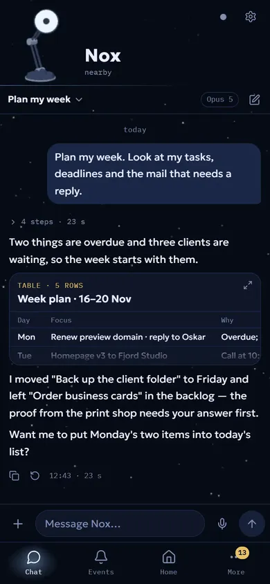
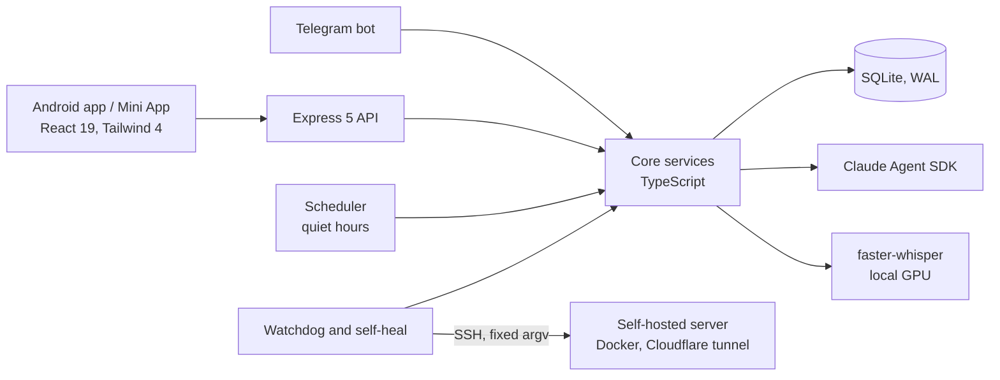

# Nox

A personal AI assistant that has run every day since April 2026: a Telegram bot, an Android app and a background agent on a self-hosted server. Single user, private code. This repository is the showcase: what it does and how it is built.

Chat screen from an early Mini App build (spring 2026). The current app is v9.x with a redesigned interface.

## What it does

- **Chat with tools.** Tasks, backlog, mail, projects and news are reachable from one conversation; answers show their steps and survive a restart.
- **Events instead of noise.** Incoming signals (client replies, accepted orders, server incidents) land as cards with one notification per batch, read items move to an archive.
- **Self-monitoring.** A watchdog tracks the server and its services. One outage produces one alert, recovery is silent, and a narrow set of repairs (for example restarting a single named container) runs without a human.
- **Voice in.** Speech is transcribed locally on a GPU before it reaches the model.
- **Content pipeline.** Drafting, scheduling and publishing posts to a Telegram channel.
- **Updates without reinstalling.** The Android shell is rebuilt only when native code changes; the interface updates itself over the air.

## Architecture

## Engineering notes

- **An automated test suite** (Vitest) runs in a pre-commit hook and in CI.
- **Model access behind one module**, so the model or tier changes in one place.
- **Dead features are switched off by list, then deleted.** A usage audit over the full history retired ten modules that nobody used.
- **Side effects get a real smoke test.** Anything that sends a message, restarts a service or touches the server is exercised against the live system before it ships.
- **Every release goes through a pull request**, 46 so far in the current repository.

## Stack

TypeScript · grammY · SQLite (better-sqlite3) · Claude Agent SDK · Express 5 · React 19 · Tailwind 4 · Capacitor (Android) · node-cron · faster-whisper · Vitest · Docker · Cloudflare Tunnel

---

Built by [BTW Studio](https://github.com/btw-hash).
